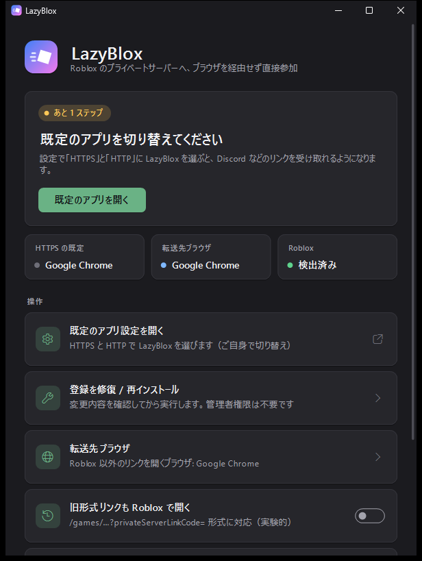
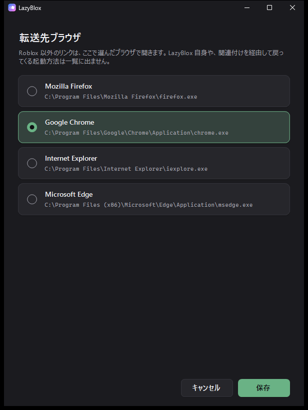

# LazyBlox — Roblox プライベートサーバー高速起動ランチャー

Discord などで `https://www.roblox.com/share?code=XXXX&type=Server` をクリックしたとき、**Web ブラウザを起動せずに**
Roblox アプリへ参加要求（ディープリンク）を直接渡す Windows 11 向けの小さな実行ファイルです。
Roblox 以外のリンクは、普段使っているブラウザへそのまま転送します。

```
Discord でリンクをクリック
   └─ Windows（https の既定アプリ = LazyBlox）
        └─ LazyBlox.exe "https://www.roblox.com/share?code=…&type=Server"
             ├─ Roblox 共有リンク(type=Server) → roblox://navigation/share_links?code=…&type=Server
             │                                   → ShellExecuteEx → Roblox クライアント
             └─ それ以外のリンク → 記録済みブラウザの exe を CreateProcess で直接起動
```

- 管理者権限は不要です。変更はすべて現在のユーザー（HKCU）だけに行います。
- 常駐しません。リンクを開くたびに起動し、すぐ終了します。
- Roblox リンクを処理するときはネットワーク通信をしません。設定ファイルも読みません。
- 既定のブラウザを勝手に切り替えることはしません。UserChoice は書き換えず、切り替えは Windows の設定画面でユーザー自身が行います。

---

## 設定画面

<p>


</p>


- **自前描画の GUI** です（Win32 + GDI+）。WinForms / WPF / 標準ダイアログは使っていないため、**表示時にシステムの通知音は鳴りません**。
- Windows の**ライト / ダーク設定とアクセントカラー**に追従し、タイトルバーも同じ配色になります。
- 高 DPI（モニターごとの拡大率）に対応し、ウィンドウはサイズ変更できます。内容が収まらない場合はホイールでスクロールします。
- キーボード操作:
  - `Tab` / `↑` / `↓`: 移動
  - `Enter` / `Space`: 決定
  - `Esc`: 戻る、または閉じる
  - `PageUp` / `PageDown`: スクロール
- 画面の構成:
  - **ホーム**: 状態カード（「あと 1 ステップ」「準備完了」など）と操作一覧
  - **確認画面**: レジストリ変更内容のプレビュー
  - **転送先ブラウザ**の選択
  - **リンクの判定テスト**: クリップボードの URL を判定します。実際には何も起動しません
  - リンク処理中の**エラー表示**: 内容をコピーできます
- GUI のコードはリンク処理の経路では読み込まれないため、リンクを開く速度には影響しません。
- スクリーンショットは `scripts\capture-ui.ps1 -Page home|browser|test|confirm|message|error` で撮れます。LazyBlox のウィンドウだけを撮影します。
  - 環境変数 `LAZYBLOX_UI_THEME=light|dark` で配色を固定できます。

## 1. インストール

### 必要なもの
- Windows 11 x64（Windows 10 でも動作する設計ですが、未検証です）
- Roblox Player（`roblox:` プロトコルが登録されていること）
- .NET ランタイムは不要です（自己完結型 exe）

### GUI でインストールする
1. `dist\LazyBlox.exe` をダブルクリックします。設定画面が開きます。
2. **インストール** を選びます。確認画面に、変更されるレジストリとファイルの一覧が表示されます。
3. **はい** を押すと、次の処理が行われます。
   - `%LOCALAPPDATA%\Programs\LazyBlox\LazyBlox.exe` へのコピー
   - HKCU へのレジストリ登録
   - 現在の既定ブラウザの検出と保存
   - 登録内容の検証
4. 続けて **Windows の既定のアプリ設定** が開きます。LazyBlox のページで **HTTPS** と **HTTP** をクリックし、**LazyBlox** を選んでください。
   - 設定画面が開かない場合は、`設定 > アプリ > 既定のアプリ` で `LazyBlox` を検索してください。

### CLI でインストールする
```bash
LazyBlox.exe plan
```
```bash
LazyBlox.exe install --yes
```
```bash
LazyBlox.exe status
```
- `plan` は、変更内容を表示するだけで何も変更しません。
- `install` に `--yes` を付けないと、変更内容を表示して終了します。
- `--browser <名前|ProgID|exeパス>` で転送先ブラウザを指定できます。
- `--in-place` を付けると、exe をコピーせず現在の場所で登録します。

### インストール時に作られるもの

すべて HKCU 配下です。

| キー | 用途 |
|---|---|
| `Software\Classes\LazyBloxURL` | http/https を受け取る ProgID（`"…\LazyBlox.exe" "%1"`） |
| `Software\Clients\StartMenuInternet\LazyBlox` (+ `\Capabilities\URLAssociations`) | 既定のアプリ画面に候補として表示するための登録 |
| `Software\RegisteredApplications` の値 `LazyBlox` | Capabilities の場所 |
| `Software\Microsoft\Windows\CurrentVersion\Uninstall\LazyBlox` | 「インストールされているアプリ」からアンインストールできるようにする |
| `%LOCALAPPDATA%\LazyBlox\config.ini` | 転送先ブラウザなどの設定 |

## 2. アンインストール
- GUI: 設定画面で **アンインストール** を選びます。
- Windows の `設定 > アプリ > インストールされているアプリ > LazyBlox > アンインストール` からも実行できます。
- CLI: `LazyBlox.exe uninstall --yes` を実行します。`--keep-config` を付けると設定ファイルを残します。

アンインストールで削除されるのは、上の表にあるこのアプリのキーと、`RegisteredApplications` の `LazyBlox` 値だけです。
他のブラウザの登録には触れません。削除後は残存チェックを行い、結果を表示します。

**既定のブラウザの復元:** HTTPS の既定が LazyBlox のままアンインストールすると、Windows は既定を未設定として扱い、次回リンクを開くときにアプリの選択を求めます。
`設定 > アプリ > 既定のアプリ` で元のブラウザ（例: Google Chrome）を選び直してください。アンインストール完了時にも同じ案内を表示します。

## 3. 対応するリンク

| 入力 | 動作 |
|---|---|
| `https://www.roblox.com/share?code=<code>&type=Server` | `roblox://navigation/share_links?code=<code>&type=Server` を Roblox で開く |
| `https://roblox.com/share?…`、`/share/`、`/share-links?…`、`http://…` | 同上 |
| `https://www.roblox.com/games/<id>/…?privateServerLinkCode=<code>` | 既定はブラウザで開く。`legacy on` にすると `roblox://placeId=<id>&linkCode=<code>` に変換（実験的） |
| その他の Roblox ページ（ゲームページ、`type=ExperienceInvite` など） | ブラウザで開く |
| 通常の http/https | ブラウザで開く |
| `javascript:`、`file:`、相対 URL、制御文字を含む URL、30,000 文字を超える URL | 拒否してエラーを表示 |

### 判定ルール

`System.Uri` で解析・正規化したあと、部分一致ではなく次の条件で判定します。

- **スキーム**: `http` または `https` のみ
- **ホスト**: `roblox.com` または `www.roblox.com` に完全一致
  - `www.roblox.com.evil.com`、`roblox.co`、末尾ドット付き、キリル文字の偽装は一致しません
  - `user@` を含む URL や既定以外のポート（例: `:8443`）も除外します
- **パス**: `/share`（末尾 `/` 可、大文字小文字は区別しない）または `/share-links`
- **クエリ**: パーセントデコードしてから評価します
  - `type` はちょうど 1 つあり、値が `Server`
  - `code` はちょうど 1 つあり、`[A-Za-z0-9_-]` の 4〜128 文字
  - `code` や `type` が重複している曖昧なリンクは、Roblox では開かずブラウザへ回します
  - `utm_*` などの余分なパラメーターとフラグメントは捨て、ディープリンクには `code` と `type` だけを渡します
- **code が不正な場合**: Roblox では開かず、ブラウザへ回します（Roblox のサイトがエラーを表示します）

### ディープリンク形式の根拠
- Roblox 公式の Deep links ドキュメントには、`roblox://placeId=<id>&launchData=…` 形式（Direct to app）が記載されています。
  パラメーター表には `linkCode`（private server link code）があり、旧形式リンクの変換はこれを根拠にしています。
- `roblox://navigation/share_links?type=…&code=…` は、Web の `www.roblox.com/share-links?type=…&code=…` に対応するディープリンクです。
  RoSeal の [roblox-deeplink-parser](https://github.com/RoSeal-Extension/roblox-deeplink-parser) がこの対応関係を実装しています。
- Roblox の [Share links](https://create.roblox.com/docs/production/promotion/share-links) と、DevForum の [Improved Private Server Links](https://devforum.roblox.com/t/improved-private-server-links/2628225) も参照しました。
- **注意:** この形式で実際に Windows 版 Roblox がサーバーに参加することは、この開発環境では**まだ確認していません**。下の「未検証事項」を参照してください。

## 4. ブラウザへの転送と無限ループ対策

- インストール時に、現在の https の既定 ProgID（例: `ChromeHTML`）を**読み取り専用で**取得します。
  その ProgID の `shell\open\command`（例: `"…\chrome.exe" --single-argument %1`）を `config.ini` に保存します。
- 転送は**ブラウザの exe を `CreateProcessW` で直接起動**して行います。`https:` を ShellExecute で開き直すことはしないため、LazyBlox が再び呼ばれることはありません。
- **引数の安全性**
  - コマンドテンプレートは、URL を入れる**前に**引数へ分解します。
  - URL は正規化済みの `AbsoluteUri` です。空白や `"` はエスケープ済みなので、常に 1 つの引数になります。
  - 環境変数の展開は exe パスにだけ行います。URL 中の `%PATH%` は文字どおり渡ります。
  - `cmd.exe` は一切使いません。
- **ループ防止（多層）**
  1. 転送先が `LazyBlox.exe` 自身、または実行中の exe と同じパスなら拒否します。
  2. `rundll32` / `explorer` / `cmd` / `powershell` / `mshta` など、関連付け経由で LazyBlox に戻りうる起動方法を拒否します。
  3. 子プロセスに環境変数 `LAZYBLOX_FORWARDED=<時刻>:<URLハッシュ>` を渡します。10 秒以内に同じ URL で再び呼ばれたら中止します。
- **転送先が起動できない場合**は、次の順に試します。
  1. 設定の ProgID から、現在のコマンドを引き直す
  2. 登録済みの他のブラウザ（`AutoDetectFallback=true` のとき）
  3. すべて失敗したら、エラーダイアログに URL を表示します
- 転送先の変更方法:
  - 設定画面の **転送先ブラウザ**
  - `LazyBlox.exe browsers` / `LazyBlox.exe set-browser "Google Chrome"`
  - `set-browser "C:\Path\browser.exe"`（exe のパスを直接指定）

### config.ini

`%LOCALAPPDATA%\LazyBlox\config.ini` に保存されます（UTF-8、key=value 形式）。

| キー | 既定 | 説明 |
|---|---|---|
| `BrowserName` | 検出値 | 表示名 |
| `BrowserProgId` | 検出値 | 例: `ChromeHTML`、`MSEdgeHTM`、`FirefoxURL-…` |
| `BrowserCommand` | 検出値 | `"exe" args %1`。`%1` / `%L` が URL に置き換わり、無ければ URL を末尾に追加 |
| `OriginalHttpsProgId` / `OriginalHttpProgId` | 検出値 | インストール前の既定（復元案内用） |
| `AutoDetectFallback` | `true` | 転送に失敗したとき、他のブラウザを試す |
| `LegacyPrivateServerLinks` | `false` | 旧形式 `/games/…?privateServerLinkCode=` の変換 |

## 5. Windows 側の仕様と制約（調査結果）

- **UserChoice は書き換えません。** Windows 10 以降、`UrlAssociations\https\UserChoice` はハッシュで保護されています。
  正規の方法は、アプリが Capabilities と RegisteredApplications に登録し、**ユーザーが設定画面で選ぶ**ことです。
  - 参考: Microsoft Learn「[Default Programs](https://learn.microsoft.com/windows/win32/shell/default-programs)」
  - LazyBlox は `ms-settings:defaultapps?registeredAppUser=LazyBlox` で自分のページを開くだけです。
- **https をまとめて受け取ります。** Windows に「特定ドメインだけ別アプリで開く」という仕組みはありません。そのため https 全体の既定アプリになり、Roblox 以外は転送します。
  - 副作用として、既定ブラウザを前提とする機能（Windows の「既定のブラウザを使用」設定など）では LazyBlox がブラウザとして扱われます。
- **Discord（デスクトップ版）**: 外部リンクは OS の既定ハンドラーで開かれます（Electron の `shell.openExternal` → ShellExecute）。
  そのため LazyBlox が受け取ります。Discord が表示する「外部リンクを開きますか？」の確認は Discord 側の機能なので、LazyBlox では省略できません。
- **ブラウザの中でクリックしたリンク**はブラウザ内で遷移するため、LazyBlox は**呼ばれません**（ブラウザ版 Discord も同じです）。
  Discord をブラウザで使っている場合は効果がありません。
- **Microsoft Edge を強制するリンク**は対象外です。Windows のウィジェットや検索などは `microsoft-edge:` プロトコルを使うため、https の既定アプリを経由しません。
- **再インストール**: 再インストールしても既定アプリの選択は通常そのまま残ります。
  ただし Windows Update などで既定がリセットされることがあり、その場合は再選択が必要です（Windows の仕様）。

## 6. パフォーマンス

計測環境: この開発機（Windows 11, x64）、Release 版（自己完結・単一ファイル・Trim・ReadyToRun、14.8 MB）。
計測方法: `scripts\benchmark.ps1`。`dry-run` で実際の起動を除き、プロセスを 40 回起動しました。表の値は、複数回の計測セッションにおける中央値の範囲です。

| 経路 | プロセス生成→起動要求直前（中央値） | 外部から測った起動〜終了（中央値） |
|---|---|---|
| Roblox 共有リンク | **42〜47 ms**（最小 38〜40） | 56〜63 ms（最小 51〜56） |
| 通常リンク（ブラウザ転送） | 45〜59 ms（最小 42〜48） | 57〜76 ms（最小 53〜62） |
| 比較: 何もしない .NET 自己完結 exe | — | 62.8 ms（最小 56.9） |

| URL 判定処理のみ（プロセス内、20 万回） | 値 |
|---|---|
| 平均 | 1.28 µs |
| p50 | 1.10 µs |
| p99 | 3.70 µs |

- LazyBlox 自身の処理は 1〜2 µs で、時間のほぼすべては .NET ランタイムの起動です（何もしない exe と同水準）。
- 起動時間を減らすために行った最適化:
  - Roblox 経路では設定ファイルを読まない
  - レジストリ参照を `RegGetValueW` で直接行う
  - `ShellExecuteExW` と `CreateProcessW` を直接呼ぶ（`System.Diagnostics.Process` を使わない）
  - InvariantGlobalization
  - コンソールを使わない WinExe
  - タイミング記録の確認は、起動要求を出した**後**に行う
- 最適化の効果: Debug（JIT）版の 75 ms から、Release 版では 42 ms になりました（プロセス生成からの時間）。
- **Native AOT** にすれば、ランタイム起動分がさらに大幅に短くなる見込みです（一般に 10〜20 ms 程度。この環境では未計測）。
  プロジェクトは AOT 対応済みで、ビルド警告はありません。ただし、ビルドには C++ ビルドツールが必要です（後述）。
- 実際の使用時に計測するには、`LazyBlox.exe timing on` を実行します。
  以後、`%LOCALAPPDATA%\LazyBlox\timing.log` に「プロセス生成から起動要求の完了まで」の時間を記録します。

## 7. ビルドとテスト

```bash
powershell -ExecutionPolicy Bypass -File build.ps1
```
```bash
powershell -ExecutionPolicy Bypass -File build.ps1 -Aot
```
```bash
powershell -ExecutionPolicy Bypass -File scripts\benchmark.ps1
```

- 1 つ目は、テストを実行してから `dist\LazyBlox.exe` を作ります（自己完結・単一ファイル・ReadyToRun）。
- 2 つ目は Native AOT 版を作ります。Visual Studio Build Tools の「C++ によるデスクトップ開発」が必要です。
- 3 つ目は性能を計測します。

| プロジェクト | 内容 |
|---|---|
| `tests/LazyBlox.Tests` | **ユニットテスト（モック）**。URL 判定、偽装ドメイン、不正コード、特殊文字、コマンド分解とクォート、ループ防止、設定、登録計画、モックのシェル・レジストリでの起動とフォールバック |
| `tests/LazyBlox.IntegrationTests` | **統合テスト**。実際の `LazyBlox.exe` をプロセスとして起動します。ブラウザは偽物の `FakeBrowser.exe` で、受け取った argv をそのまま記録します。レジストリ登録は `HKCU\Software\LazyBloxTest\<guid>` 配下のサンドボックスで行います |
| `RealExternalTests`（統合テスト内） | **実アプリを使うテスト**。既定ではスキップします。`LAZYBLOX_REAL_TESTS=1` と `LAZYBLOX_REAL_SHARE_URL` を設定したときだけ、実際の Roblox とブラウザを起動します |

要件のテスト項目との対応:
1. 正常な共有リンク
2. 一般の Roblox ページ
3. 通常サイト
4. 不正な URL
5. 不正なコード
6. Roblox 未インストール時のフォールバック（モック）
7. ブラウザが無い場合
8. 空白や特殊文字
9. 自分自身や別名コピーによる再帰
10. 登録と解除の 5 回繰り返し
11. 複数 URL の同時処理（12 プロセス同時起動を含む）
12. ディープリンク起動失敗時のフォールバック（モック）

## 8. CLI リファレンス

```
LazyBlox.exe                      設定画面 (GUI)
LazyBlox.exe <URL> [URL…]         リンクを処理（Windows から呼ばれる形式）
LazyBlox.exe status | verify      登録状態 / 検証（残存チェックを含む）
LazyBlox.exe plan [uninstall]     変更内容のプレビュー
LazyBlox.exe install [--yes] [--in-place] [--browser X] [--no-settings]
LazyBlox.exe uninstall [--yes] [--keep-config]
LazyBlox.exe browsers | set-browser <X> | default-apps
LazyBlox.exe dry-run <URL>        判定と実行予定（起動しない）とその所要時間
LazyBlox.exe bench [URL] [回数]
LazyBlox.exe timing on|off | legacy on|off
```

終了コード:

| コード | 意味 |
|---|---|
| 0 | 成功 |
| 1 | 使い方の誤り、または `--yes` 未指定 |
| 2 | URL を拒否した |
| 3 | ブラウザを起動できない |
| 4 | ループを検出した |
| 5 | その他のエラー |

## 9. トラブルシューティング

| 症状 | 対処 |
|---|---|
| 既定のアプリに LazyBlox が出てこない | `LazyBlox.exe verify` で登録を確認します。問題があれば設定画面から再インストールします。設定アプリを開き直し、`LazyBlox` で検索してください |
| リンクを開くと毎回アプリ選択が出る | Windows が既定を確定していません。「常に使う」にチェックを入れて LazyBlox を選ぶか、既定のアプリ画面で HTTPS と HTTP を LazyBlox にしてください |
| Roblox リンクがブラウザで開く | `LazyBlox.exe dry-run "<リンク>"` で判定を確認します。`type=Server` ではない共有リンク（例: `ExperienceInvite`）は仕様どおりブラウザで開きます。`roblox: プロトコル` が「見つかりません」と出る場合は Roblox を再インストールしてください |
| Roblox は起動するがサーバーに入らない | Roblox クライアントがディープリンクに対応していない可能性があります（未検証事項を参照）。ブラウザ版の共有リンクで参加できるか確認してください |
| 通常リンクで「ブラウザを起動できませんでした」 | ブラウザの更新や移動で exe のパスが変わった可能性があります。`LazyBlox.exe browsers` → `set-browser <名前>`、または設定画面で選び直してください |
| 「転送ループを検出」 | 転送先が LazyBlox に戻る設定になっています。`set-browser` で実際のブラウザを指定してください |
| アンインストール後にリンクが開けない | `設定 > アプリ > 既定のアプリ` で元のブラウザを HTTPS/HTTP の既定に戻してください |
| 起動が遅い | 初回はディスクキャッシュの影響で遅くなります。`timing on` で計測し、ウイルス対策ソフトの除外を検討するか、AOT 版を使ってください |

## 10. 未検証事項・制約（正直な一覧）

- **実際の Roblox 参加は未検証です。** `roblox://navigation/share_links?code=…&type=Server` を Windows 版 Roblox が受け付けて参加することは、まだ確認していません。
  - 確認には実際のサーバーへの参加が必要なため、承認待ちにしています。
  - 確認するには `RealExternalTests` を使うか、インストール後に Discord から実際のリンクを開いてください。
- **Windows の既定のアプリ画面での表示と選択（実機）は未検証です。** この開発中は実レジストリに登録していません。
  - 検証は HKCU のサンドボックスキーで行いました。
- **Discord から呼び出される実際の経路は未検証です**（Windows の仕様と Electron の挙動から設計しています）。
- 旧形式リンク（`linkCode`）の変換は実験的で、既定はオフです。
- Native AOT 版はまだビルドしていません。この環境に MSVC リンカーが無いためです。
- ストア版などの AppX ブラウザで ProgID に `shell\open\command` が無い場合は、`StartMenuInternet` に登録されたブラウザ exe を使います。それも無い場合は `set-browser <exeパス>` で指定してください。

## 11. アイコン

- アイコンの元画像は [assets/icon.png](assets/icon.png)（1024×1024、透過 PNG）です。編集したら次のコマンドで `src/LazyBlox/app.ico` を作り直します（16〜256px の各サイズを含みます）。
  ```bash
  powershell -ExecutionPolicy Bypass -File scripts\make-icon.ps1 -FromPng assets\icon.png
  ```
- 設定画面左上のロゴはコードで描画しています（`Ui.Logo`、同じ形と配色）。

## ライセンス

[GNU General Public License v3.0](LICENSE)

LazyBlox は非公式のツールです。Roblox Corporation とは関係がなく、同社による承認も受けていません。「Roblox」は Roblox Corporation の商標です。