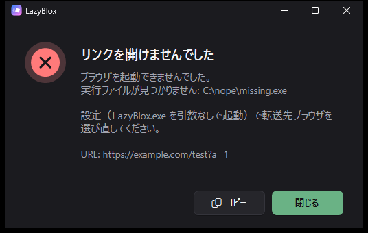
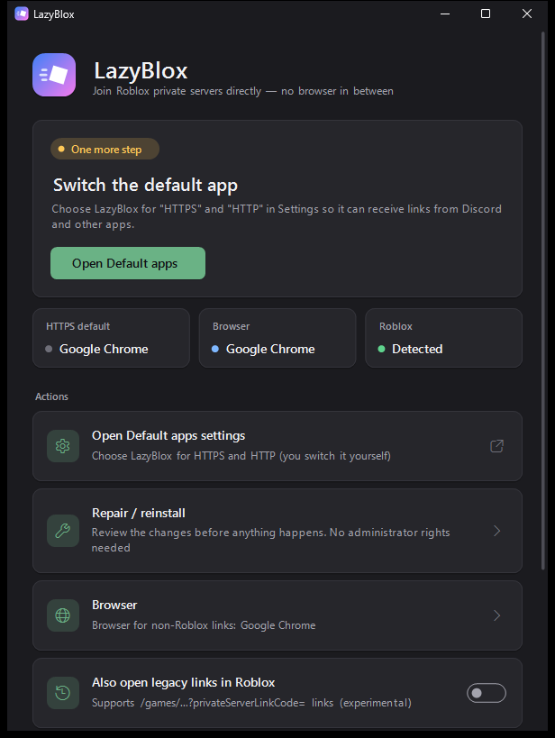
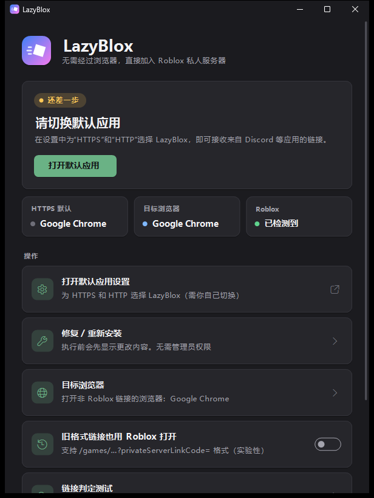

# LazyBlox — Roblox プライベートサーバー高速起動ランチャー
↓↓↓↓↓↓↓↓↓↓↓↓↓↓↓↓↓↓↓↓↓↓↓↓
## Discord などで `https://www.roblox.com/share?code=XXXX&type=Server` をクリックしたとき、**Web ブラウザを起動せずに** Roblox アプリへ参加要求（ディープリンク）を直接渡す Windows 11 向けの軽量ランチャーです。  
### Roblox 以外の通常リンクは、普段使っているブラウザへそのまま転送します。
↑↑↑↑↑↑↑↑↑↑↑↑↑↑↑↑↑↑↑↑↑↑↑↑

```text
Discord などでリンクをクリック
  └─ Windows（https の既定アプリ = LazyBlox）
       └─ LazyBlox.exe "https://www.roblox.com/share?code=…&type=Server"
            ├─ Roblox 共有リンク (type=Server)
            │    └─ roblox://navigation/share_links?code=…&type=Server
            │         └─ ShellExecuteEx → Roblox クライアントを直接起動
            └─ それ以外のリンク
                 └─ 記録済みブラウザの exe を CreateProcess で直接起動
```

### 主な特徴

- **管理者権限不要**: 変更はすべて現在のユーザー領域（`HKCU`）および `%LOCALAPPDATA%` のみに行います。
- **非常駐型**: リンクを開くたびに起動し、処理が終わると即座に終了します。
- **軽量・高速**: Roblox リンクを処理するときはネットワーク通信を行わず、設定ファイルも読み込みません。
- **安全な既定アプリ登録**: レジストリの `UserChoice` を勝手に書き換えることはしません。切り替えは Windows の設定画面からユーザー自身で行います。

---

## 目次

- [設定画面（GUI）](#設定画面gui)
- [インストールとアンインストール](#インストールとアンインストール)
- [対応するリンクと判定ルール](#対応するリンクと判定ルール)
- [ブラウザへの転送とループ防止](#ブラウザへの転送とループ防止)
- [Windows 側の仕様と制約](#windows-側の仕様と制約)
- [トラブルシューティング](#トラブルシューティング)
- [既知の制約](#既知の制約)
- [CLI リファレンス](#cli-リファレンス)
- [パフォーマンス](#パフォーマンス)
- [ビルドとテスト](#ビルドとテスト)
- [アイコンと多言語対応](#アイコンと多言語対応)
- [ライセンス](#ライセンス)

---

## 設定画面（GUI）

<p>


</p>


- **自前描画の軽量 GUI**: Win32 + GDI+ で実装しており、WinForms / WPF / 標準ダイアログを使用しないため**表示時にシステム通知音が鳴りません**。
- **テーマ連動**: Windows のライト / ダーク設定とアクセントカラーに追従し、タイトルバーも同色に揃います。
- **柔軟な表示**: 高 DPI（モニターごとの拡大率）とウィンドウリサイズに対応し、コンテンツが収まらない場合はマウスホイールでスクロールできます。
- **高速起動への配慮**: リンク処理の経路では GUI コードを一切読み込まないため、リンクを開く速度に影響しません。

### 画面構成と操作

- **画面一覧**:
  - **ホーム**: 現在の状態カード（「あと 1 ステップ」「準備完了」など）と各操作メニュー
  - **確認画面**: インストール・アンインストール時のレジストリ変更内容のプレビュー
  - **転送先ブラウザ**: Roblox 以外のリンクを開くブラウザの選択
  - **リンクの判定テスト**: クリップボード内の URL をテスト判定（実際には何も起動しません）
  - **エラー表示**: リンク処理に失敗した際の内容表示とコピー
- **キーボード操作**:
  - `Tab` / `↑` / `↓`: 項目の移動
  - `Enter` / `Space`: 決定
  - `Esc`: 戻る、または閉じる
  - `PageUp` / `PageDown`: スクロール
- **スクリーンショットの撮影**:
  - `scripts\capture-ui.ps1 -Page home|browser|test|confirm|message|error` で LazyBlox のウィンドウだけを撮影できます。
  - 環境変数 `LAZYBLOX_UI_THEME=light|dark` で配色を固定できます。

---

## インストールとアンインストール

### 動作要件

- **OS**: Windows 11 x64（Windows 10 でも動作する設計ですが未検証です）
- **アプリ**: Roblox Player（`roblox:` プロトコルが登録されていること）
- **ランタイム**: 不要（自己完結型の単一実行ファイル）

### インストール手順（GUI）

1. `dist\LazyBlox.exe` をダブルクリックして設定画面を開きます。
2. **インストール** を選択し、確認画面で変更されるレジストリとファイルを確認して **はい** を押します。
   - `%LOCALAPPDATA%\Programs\LazyBlox\LazyBlox.exe` へのコピー
   - `HKCU` へのレジストリ登録
   - 現在の既定ブラウザの検出と保存
   - 登録内容の検証
3. 続けて **Windows の既定のアプリ設定** が開きます。LazyBlox のページで **HTTPS** と **HTTP** をそれぞれクリックし、**LazyBlox** を選択してください。
   - 設定画面が自動で開かない場合は、`設定 > アプリ > 既定のアプリ` から `LazyBlox` を検索してください。

### インストール手順（CLI）

```bash
LazyBlox.exe plan           # 変更内容のプレビュー（変更は行わない）
LazyBlox.exe install --yes  # インストールを実行（--yes なしではプレビューのみ）
LazyBlox.exe status         # 現在の登録状態を確認
```

- `--browser <名前|ProgID|exeパス>`: 転送先ブラウザを明示的に指定します。
- `--in-place`: ファイルをコピーせず、現在の配置場所のまま登録します。

### インストール時に作成される項目

すべて現在のユーザー領域（`HKCU`）およびローカルフォルダ配下のみです。

| 対象 | 用途 |
|---|---|
| `HKCU\Software\Classes\LazyBloxURL` | http / https を受け取る ProgID（`"…\LazyBlox.exe" "%1"`） |
| `HKCU\Software\Clients\StartMenuInternet\LazyBlox` | 既定のアプリ画面に候補として表示するための登録（`+ \Capabilities\URLAssociations`） |
| `HKCU\Software\RegisteredApplications` の値 `LazyBlox` | Capabilities の参照先 |
| `HKCU\Software\Microsoft\Windows\CurrentVersion\Uninstall\LazyBlox` | 「インストールされているアプリ」から削除できるようにする登録 |
| `%LOCALAPPDATA%\LazyBlox\config.ini` | 転送先ブラウザなどの設定ファイル |

### アンインストール

以下のいずれかの方法でアンインストールできます。

- **GUI**: 設定画面から **アンインストール** を選択
- **Windows 設定**: `設定 > アプリ > インストールされているアプリ > LazyBlox > アンインストール`
- **CLI**: `LazyBlox.exe uninstall --yes`（設定ファイルを残す場合は `--keep-config` を付与）

アンインストール時は上表のキーと `RegisteredApplications` の `LazyBlox` 値のみを削除し、他ブラウザの設定には触れません。削除後は残存チェックを実行して結果を表示します。

> **既定のブラウザの復元について:**  
> HTTPS の既定が LazyBlox のままアンインストールすると、Windows は既定ブラウザを未設定として扱い、次回リンクを開く際にアプリ選択を求めるようになります。アンインストール後は `設定 > アプリ > 既定のアプリ` から元のブラウザ（例: Google Chrome）を選び直してください。

---

## 対応するリンクと判定ルール

| 入力 URL | 動作 |
|---|---|
| `https://www.roblox.com/share?code=<code>&type=Server` | `roblox://navigation/share_links?code=<code>&type=Server` を Roblox で直接開く |
| `https://roblox.com/share?…`、`/share/`、`/share-links?…`、`http://…` | 同上 |
| `https://www.roblox.com/games/<id>/…?privateServerLinkCode=<code>` | 既定ではブラウザへ転送（`legacy on` 設定時のみ `roblox://placeId=<id>&linkCode=<code>` に変換 ※実験的） |
| その他の Roblox ページ（ゲームページ、`type=ExperienceInvite` など） | ブラウザで開く |
| 通常の `http` / `https` リンク | ブラウザで開く |
| `javascript:`、`file:`、相対 URL、制御文字を含む URL、30,000 文字超の URL | 拒否してエラーを表示 |

### URL 判定ルール

`System.Uri` で解析・正規化したうえで、部分一致ではなく以下の厳格な条件で判定します。

- **スキーム**: `http` または `https` のみ許可。
- **ホスト**: `roblox.com` または `www.roblox.com` への完全一致。
  - 偽装ドメイン（`www.roblox.com.evil.com`、`roblox.co`、末尾ドット、キリル文字の同形異字）は除外します。
  - `user@` を含む URL や既定以外のポート番号（例: `:8443`）も除外します。
- **パス**: `/share`（末尾 `/` 可、大文字小文字は不問）または `/share-links`。
- **クエリ**: パーセントデコード後に評価します。
  - `type` パラメーターがちょうど 1 つあり、値が `Server` であること。
  - `code` パラメーターがちょうど 1 つあり、`[A-Za-z0-9_-]` の 4〜128 文字であること。
  - `code` や `type` が重複している曖昧な URL や `code` が不正な URL は、Roblox ではなくブラウザへ転送します。
  - `utm_*` などの不要なパラメーターとフラグメント（`#...`）は破棄し、ディープリンクには `code` と `type` のみを渡します。

### ディープリンク形式の根拠

- `roblox://navigation/share_links?type=…&code=…` は Web の `www.roblox.com/share-links?type=…&code=…` に対応するディープリンク形式であり、RoSeal の [roblox-deeplink-parser](https://github.com/RoSeal-Extension/roblox-deeplink-parser) でも同様の対応関係が実装されています（Windows 版 Roblox でのサーバー参加についても実機で確認済みです）。
- 旧形式変換（`roblox://placeId=<id>&linkCode=<code>`）は、Roblox 公式の Deep links ドキュメントに記載されているパラメーター仕様を根拠としています。
- あわせて Roblox の [Share links](https://create.roblox.com/docs/production/promotion/share-links) および DevForum の [Improved Private Server Links](https://devforum.roblox.com/t/improved-private-server-links/2628225) を参照しています。

---

## ブラウザへの転送とループ防止

### 転送の仕組みと引数の安全性

- インストール時に、現在の `https` の既定 ProgID（例: `ChromeHTML`）を読み取り専用で取得し、`shell\open\command`（例: `"…\chrome.exe" --single-argument %1`）を `config.ini` に保存します。
- 転送時は `https:` を再実行するのではなく、**ブラウザの実行ファイルを `CreateProcessW` で直接起動**します。
- コマンドテンプレートは URL を差し込む**前に**引数へ分解し、URL は正規化済みの `AbsoluteUri` として渡します（空白や `"` はエスケープ済みのため、常に 1 つの引数として扱われます）。
- 環境変数の展開は exe パスのみに適用し、URL 内の `%PATH%` などが展開されないよう保護しています。`cmd.exe` は一切介しません。

### 多層ループ防止とフォールバック

転送先の設定不備による無限ループを防ぐため、以下のチェックを行います。

1. 転送先が `LazyBlox.exe` 自身、または現在実行中の exe と同じパスの場合は起動を拒否します。
2. `rundll32` / `explorer` / `cmd` / `powershell` / `mshta` など、OS の関連付け経由で LazyBlox に戻りうる呼び出し方法を拒否します。
3. 子プロセスに環境変数 `LAZYBLOX_FORWARDED=<時刻>:<URLハッシュ>` を渡し、10 秒以内に同じ URL で再帰呼び出しされた場合は処理を中止します。

ブラウザが起動できない場合は、次の優先順でフォールバックします。

1. 設定された ProgID から現在の起動コマンドを再取得して試行
2. システムに登録されている他のブラウザを試行（`AutoDetectFallback=true` の場合）
3. すべて失敗した場合は、エラーダイアログに開けなかった URL を表示

### 転送先ブラウザの変更と `config.ini`

転送先の変更は、設定画面の **転送先ブラウザ**、または以下の CLI コマンドで行えます。

```bash
LazyBlox.exe browsers
LazyBlox.exe set-browser "Google Chrome"
LazyBlox.exe set-browser "C:\Path\To\browser.exe"
```

設定は `%LOCALAPPDATA%\LazyBlox\config.ini`（UTF-8、`key=value` 形式）に保存されます。

| キー | 既定値 | 説明 |
|---|---|---|
| `BrowserName` | 自動検出値 | 表示名 |
| `BrowserProgId` | 自動検出値 | 例: `ChromeHTML`、`MSEdgeHTM`、`FirefoxURL-…` |
| `BrowserCommand` | 自動検出値 | `"exe" args %1`（`%1` / `%L` が URL に置換。無ければ末尾に追加） |
| `OriginalHttpsProgId` / `OriginalHttpProgId` | 自動検出値 | インストール前の既定 ProgID（復元案内用） |
| `AutoDetectFallback` | `true` | 転送失敗時に他ブラウザへのフォールバックを試みるか |
| `LegacyPrivateServerLinks` | `false` | 旧形式 `/games/…?privateServerLinkCode=` を変換するか |

---

## Windows 側の仕様と制約

- **`UserChoice` は書き換えません**: Windows 10 以降、`UrlAssociations\https\UserChoice` はハッシュで保護されています。Microsoft 公式の [Default Programs](https://learn.microsoft.com/windows/win32/shell/default-programs) に従い、LazyBlox は候補として登録したうえで `ms-settings:defaultapps?registeredAppUser=LazyBlox` を開くのみとしています。
- **`https` 全体の既定アプリになります**: Windows には「特定ドメインだけ別アプリで開く」機能がないため、`https` 全体を受け取り、Roblox 以外を転送する設計です。そのため「既定のブラウザを使用」と表記される一部機能では LazyBlox が既定ブラウザとして扱われます。
- **対象となるアプリ / 対象外の動作**:
  - **Discord（デスクトップ版）**: 外部リンクは OS の既定ハンドラー（Electron の `shell.openExternal` → `ShellExecute`）で開かれるため、LazyBlox が受け取ります。なお、Discord 側の「外部リンクを開きますか？」という確認ダイアログは省略できません。
  - **Web ブラウザ内・ブラウザ版 Discord**: ブラウザ内部でページ遷移するため LazyBlox は呼ばれません。
  - **Edge を強制するリンク**: Windows ウィジェットや検索など `microsoft-edge:` プロトコルを使うリンクは対象外です。
- **再インストールと Windows Update**: 再インストールしても既定アプリの選択は原則維持されますが、Windows Update 等でリセットされた場合は設定画面から選び直す必要があります。

---

## トラブルシューティング

| 症状 | 対処方法 |
|---|---|
| 既定のアプリに LazyBlox が出てこない | `LazyBlox.exe verify` で登録状態を確認し、問題があれば再インストールしてください。その後、設定アプリを開き直して `LazyBlox` を検索してください。 |
| リンクを開くたびにアプリ選択が出る | Windows 側で既定が確定していません。選択ダイアログで「常に使う」にチェックを入れて LazyBlox を選ぶか、設定画面で HTTPS と HTTP を LazyBlox に設定してください。 |
| Roblox リンクがブラウザで開く | `LazyBlox.exe dry-run "<リンク>"` で判定結果を確認してください。`type=Server` 以外（例: `ExperienceInvite`）は仕様どおりブラウザで開きます。`roblox:` プロトコルが見つからない場合は Roblox を再インストールしてください。 |
| リンクを押しても、起動中の Roblox が反応しない（ゲーム中も移動しない） | Roblox を一度完全に終了し、起動し直してから、もう一度リンクを開いてください。長時間（約 1 日）起動したままの Roblox が、リンクを受信しても何もしなくなった事例を確認しています（Roblox のログに `receiving deeplink` だけが出て、その後ゲームの起動が記録されない）。起動し直したあとは、ゲーム中でもリンクで移動できました。LazyBlox が呼ばれているかは `timing on` で確認できます（`%LOCALAPPDATA%\LazyBlox\timing.log` に記録が増えれば正常）。 |
| Roblox は起動するがサーバーに入らない | Roblox クライアント側の仕様変更や一時的な不具合、またはリンク無効化の可能性があります。ブラウザ版のリンクから参加できるかご確認ください。 |
| 通常リンクで「ブラウザを起動できませんでした」と出る | ブラウザの更新等で exe パスが変わった可能性があります。設定画面または `LazyBlox.exe browsers` → `set-browser <名前>` で選び直してください。 |
| 「転送ループを検出」と表示される | 転送先が LazyBlox に戻る設定になっています。`set-browser` で実際のブラウザを指定してください。 |
| アンインストール後にリンクが開けない | `設定 > アプリ > 既定のアプリ` で元のブラウザを HTTPS / HTTP の既定に戻してください。 |
| 起動が遅く感じる | 初回起動はディスクキャッシュの影響で時間がかかります。`timing on` で計測し、必要に応じてウイルス対策ソフトの除外設定や Native AOT 版の利用を検討してください。 |

---

## 既知の制約

- **Windows 10 での動作**: Windows 10 でも動作するよう設計していますが、実機検証は Windows 11 環境のみで行っています。
- **Native AOT ビルド**: プロジェクトは AOT 対応済み（警告なし）ですが、開発環境に MSVC リンカーがないため AOT 版のビルドおよび実測は未実施です。
- **旧形式リンク変換**: `/games/…?privateServerLinkCode=` の変換機能は実験的機能であり、既定ではオフになっています。
- **ストア版（AppX）ブラウザ**: ProgID に `shell\open\command` が存在しない場合、`StartMenuInternet` に登録されたブラウザ exe を使用します。それも存在しない場合は `set-browser <exeパス>` で直接指定してください。

---

## CLI リファレンス

```text
LazyBlox.exe                      設定画面（GUI）を起動
LazyBlox.exe <URL> [URL…]         リンクを処理（Windows から呼ばれる標準形式）
LazyBlox.exe status | verify      登録状態の表示 / 検証（残存チェックを含む）
LazyBlox.exe plan [uninstall]     インストール・アンインストール時の変更プレビュー
LazyBlox.exe install [--yes] [--in-place] [--browser X] [--no-settings]
LazyBlox.exe uninstall [--yes] [--keep-config]
LazyBlox.exe browsers | set-browser <X> | default-apps
LazyBlox.exe dry-run <URL>        URL 判定と実行予定の確認（実際には起動しない）
LazyBlox.exe bench [URL] [回数]   プロセス内ベンチマークを実行
LazyBlox.exe timing on|off        実行時間のログ記録を切り替え
LazyBlox.exe legacy on|off        旧形式リンク変換の有効・無効を切り替え
```

### 終了コード

| コード | 意味 |
|---|---|
| `0` | 成功 |
| `1` | コマンドの使い方の誤り、または `--yes` 未指定 |
| `2` | URL を拒否した |
| `3` | ブラウザを起動できなかった |
| `4` | 転送ループを検出した |
| `5` | その他のエラー |

---

## パフォーマンス

### 計測結果

- **計測環境**: Windows 11 x64 / Release 版（自己完結・単一ファイル・Trim・ReadyToRun、14.8 MB）
- **計測方法**: `scripts\benchmark.ps1` を用い、`dry-run` モードで実際のアプリ起動を除きプロセスを 40 回起動（表は複数セッションの中央値の範囲）。

| 経路 | プロセス生成 → 起動要求直前（中央値） | 外部計測による起動 〜 終了（中央値） |
|---|---|---|
| Roblox 共有リンク | **42〜47 ms**（最小 38〜40 ms） | 56〜63 ms（最小 51〜56 ms） |
| 通常リンク（ブラウザ転送） | 45〜59 ms（最小 42〜48 ms） | 57〜76 ms（最小 53〜62 ms） |
| 参考: 何もしない .NET 自己完結 exe | — | 62.8 ms（最小 56.9 ms） |

| URL 判定処理のみ（プロセス内・20 万回実行） | 計測値 |
|---|---|
| 平均 | 1.28 µs |
| p50 | 1.10 µs |
| p99 | 3.70 µs |

### 最適化と計測ログ

LazyBlox 自身の処理時間は 1〜2 µs 程度であり、所要時間の大半は .NET ランタイムの起動時間です。起動オーバーヘッドを抑えるため、以下の最適化を行っています（Debug 版の 75 ms から Release 版では 42 ms まで短縮）。

- Roblox 経路では設定ファイルを読み込まない
- `RegGetValueW` による直接的なレジストリ参照
- `System.Diagnostics.Process` を使わず、`ShellExecuteExW` と `CreateProcessW` を直接呼び出す
- InvariantGlobalization の有効化、およびコンソールを割り当てない WinExe 化
- タイミングログの確認処理を、起動要求を出した**後**に実行

> **Note:** Native AOT ビルドを利用するとランタイム起動時間がさらに短縮され、10〜20 ms 程度での動作が見込まれます。また、実使用時の所要時間を計測したい場合は `LazyBlox.exe timing on` を実行すると、`%LOCALAPPDATA%\LazyBlox\timing.log` に起動要求完了までの時間が記録されます。

---

## ビルドとテスト

```powershell
# テストを実行し、dist\LazyBlox.exe をビルド（自己完結・単一ファイル・ReadyToRun）
powershell -ExecutionPolicy Bypass -File build.ps1

# Native AOT 版をビルド（Visual Studio Build Tools の「C++ によるデスクトップ開発」が必要）
powershell -ExecutionPolicy Bypass -File build.ps1 -Aot

# パフォーマンス計測を実行
powershell -ExecutionPolicy Bypass -File scripts\benchmark.ps1
```

### テストスイート構成

| プロジェクト | 内容 |
|---|---|
| `tests/LazyBlox.Tests` | **ユニットテスト（モック使用）**: URL 判定、偽装ドメイン、不正コード、特殊文字、コマンド分解とクォート、ループ防止、設定、登録計画、モック環境での起動・フォールバック |
| `tests/LazyBlox.IntegrationTests` | **統合テスト**: 実際の `LazyBlox.exe` をプロセス起動して検証。ブラウザ役には受け取った `argv` を記録するダミーの `FakeBrowser.exe` を使用し、レジストリ登録は `HKCU\Software\LazyBloxTest\<guid>` 配下のサンドボックスで実施 |
| `RealExternalTests`（統合テスト内） | **実アプリ連携テスト**: 既定ではスキップ。環境変数 `LAZYBLOX_REAL_TESTS=1` および `LAZYBLOX_REAL_SHARE_URL` を設定したときのみ実際の Roblox とブラウザを起動 |

テスト項目は要件の以下 12 ケースを網羅しています。
1. 正常な共有リンク / 2. 一般の Roblox ページ / 3. 通常サイト / 4. 不正な URL / 5. 不正なコード / 6. Roblox 未インストール時のフォールバック（モック） / 7. ブラウザが無い場合 / 8. 空白や特殊文字 / 9. 自分自身や別名コピーによる再帰 / 10. 登録と解除の 5 回繰り返し / 11. 複数 URL の同時処理（12 プロセス同時起動を含む） / 12. ディープリンク起動失敗時のフォールバック（モック）

---

## アイコンと多言語対応

### アイコン

- 元画像は [assets/icon.png](assets/icon.png)（1024×1024 透過 PNG）です。編集後は以下のコマンドで 16〜256 px を含む `src/LazyBlox/app.ico` を再生成できます。
  ```powershell
  powershell -ExecutionPolicy Bypass -File scripts\make-icon.ps1 -FromPng assets\icon.png
  ```
- 設定画面左上のロゴは、`Ui.Logo` によって同じ形状・配色でコード描画されています。

### 多言語対応

画面・エラー・CLI の表示は Windows の表示言語（`GetUserDefaultUILanguage`）に応じて自動で切り替わります。環境変数 `LAZYBLOX_LANG` で任意の言語に固定することも可能です（例: `set LAZYBLOX_LANG=en`）。

| 言語 | コード |
|---|---|
| English（下記以外の言語はすべて英語） | `en` |
| 日本語 | `ja` |
| 简体中文 | `zh-Hans` |
| 繁體中文（台湾・香港・マカオ） | `zh-Hant` |
| 한국어 | `ko` |
| Español | `es` |
| Português | `pt` |

- 翻訳文字列は `src/LazyBlox/Localization/Lang.*.cs` に 1 言語 1 ファイルで管理されています。`required` プロパティにより項目漏れはビルドエラーとして検出され、プレースホルダー `{0}` の個数不一致はテストで検出します。
- 見出しには言語ごとの最適なフォントを使用します（日本語: Yu Gothic UI、中国語: Microsoft YaHei UI / JhengHei UI、韓国語: Malgun Gothic）。

| English | 简体中文 |
|---|---|
|  |  |

---

## ライセンス

[GNU General Public License v3.0](LICENSE)

LazyBlox は非公式のツールであり、Roblox Corporation とは関係がなく、同社による承認も受けていません。「Roblox」は Roblox Corporation の商標です。